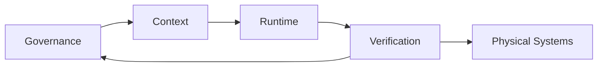

# **👋 Hello, I'm Don Michael.**
"**Design top-down. Verify bottom-up. Release with evidence.**"

*Creativity and technical rigor are complementary phases of the same engineering process.*

  

### **Systems Architect • AI Safety Researcher • Independent Builder**

I build systems where **AI, software, and the physical world** meet. What drives me is a simple question: how can we make powerful technology understandable, dependable, and worthy of trust? I work toward that by setting clear boundaries, making decisions traceable, preparing for failure, and letting evidence speak for the work.

These repositories are my independent research workshop, spanning software, hardware, mathematics, music, animation, and scientific tools. I enjoy following difficult questions across disciplines, then doing the careful work to make each idea testable, reproducible, and useful to others.

---

## **Research Program**

The projects take different paths, but the engineering commitments behind them are shared:

- **Governance and context** — trust membranes, attributable context transfer, policy constraints, and bounded behavior for agentic systems.
- **Runtime and verification** — deterministic pipelines, distributed and verifiable computation, reproducible evaluation, and explicit failure handling.
- **Physical and embedded systems** — computer vision, smart glasses, EV and battery systems, biosignals, and other interfaces where computational decisions meet the physical world.
- **Mathematical and scientific foundations** — nonlinear dynamics, phase memory, invariant-driven modeling, simulation, and falsifiable reference implementations.
- **Interoperability** — practical bridges between legacy and modern compute without hiding system state or weakening governance boundaries.

Different projects, one recurring challenge: **how can we make complex systems useful without losing the ability to understand, test, and recover them?**

### **Research Architecture**

Governance defines permitted action; context supplies attributable state; runtimes execute within those boundaries; verification closes the loop; and physical systems provide the hardest test of whether the architecture behaves as intended.

---

## **Noteworthy and favorite Repositories**

| **Repository** | **What it explores** |
|---|---|
| **[AILEE Trust Layer](https://github.com/dfeen87/AILEE-Trust-Layer)** | An adaptive trust and governance middleware architecture that evaluates AI-generated decisions before they become system actions. Integrates deterministic trust scoring, confidence thresholds, contextual mediation (GRACE), distributed consensus, auditable decision pathways, and stability-preserving fallback mechanisms across multiple computational and industrial domains. |
| **[Ambient AI + VCP System](https://github.com/dfeen87/Ambient-AI-VCP-System)** | A distributed, verifiable computing architecture coordinating heterogeneous devices, AI workloads, and decentralized processing resources through a unified orchestration framework. Combines node-health intelligence, trust-based task scheduling, cryptographic verification with zero-knowledge proofs, and resilient offline-first operating capabilities. |
| **[AeroCam](https://github.com/dfeen87/AeroCam)** | A multidisciplinary C++ engineering framework exploring real-time motion intelligence, embedded control systems, inertial sensor fusion, and computational camera stabilization. Integrates ARM Cortex-M firmware, Extended Kalman Filtering, OpenFX video-processing tools, and experimental motion-aware computer vision applications for aerospace, filmmaking, and augmented reality. |
| **[ISLA](https://github.com/dfeen87/ISLA)** | An experimental digital audio signal-processing platform investigating phase-aware note smoothing, harmonic blending, and perceptually connected musical transitions. Combines offline WAV processing, real-time macOS system-audio monitoring, and interactive terminal and desktop interfaces with Velvet, Legato, Melt, and transparent Bypass listening modes. |
| **[U.F.O.](https://github.com/dfeen87/UFO)** | A governed, compute-aware AI architecture modeling adaptive behavior and computational constraints through a deformable radial membrane and dynamically routed V-Channels. Integrates bounded reasoning, geometric stability control, behavioral governance, trust memory, adaptive recurrence, and auditable simulation to investigate computationally responsible AI personalization. |
| **[Context Broker](https://github.com/dfeen87/Context-Broker)** | A vendor-neutral context-interoperability framework supporting controlled information exchange between AI systems, software applications, and connected devices. Uses explicitly authorized, time-bounded, attributable context packets with deterministic expiration, provenance tracking, and ALCOA-oriented auditability to reduce uncontrolled persistence and cross-system ambiguity. |
| **[DS-EV](https://github.com/dfeen87/DS-EV)** | A research-stage electric-vehicle battery intelligence and energy-governance architecture investigating dual-state battery modeling, degradation estimation, regenerative-energy management, and battery-aware power control. Combines C++/Python simulation, safety-boundary enforcement, energy-continuity accounting, and auditable BMS middleware, with physical vehicle validation remaining outside its established capabilities. |
| **[ZORG-Animation-Engine](https://github.com/dfeen87/ZORG-Animation-Engine)** | Exploring the intersection of mathematics, motion, and visual expression through procedural geometry, governed numerical dynamics, and reproducible simulation. Transforming mathematical fields and computational principles into expressive visual forms, advancing new possibilities in animation and creative computing. |

**Where to start:** begin with **AILEE Trust Layer** for the governance model, then follow **Context Broker** and **Ambient AI + VCP System** through context, execution, and verification. **AeroCam**, **Trust Beacon**, and **DS-EV** show those principles applied at physical-system boundaries; **Phase-Memory Operator** provides a mathematical lens on state change and memory.

---

## **Engineering Principles**

Whatever I'm building, these are the qualities I work toward:

- **Interpretable** — important state and decision boundaries are visible.
- **Deterministic where it matters** — identical inputs and conditions support reproducible evaluation.
- **Auditable** — actions, transitions, and provenance leave inspectable records.
- **Falsifiable** — research claims can be tested against simulations, benchmarks, or explicit invariants.
- **Fail-safe** — unsafe transitions are constrained and fallback paths remain available.
- **Composable** — governance, context, runtime, and verification can evolve without collapsing their boundaries.

The work is research-stage unless a repository states otherwise. I use terms such as *reference implementation*, *simulation*, and *validated benchmark* deliberately so that exploratory results are not mistaken for production claims.

---

## **Background & Education**

My perspective is shaped by hands-on manufacturing, quality work, technical writing, and independent research. They've taught me that good engineering involves not just getting something to work, but making it clear, dependable, and considerate of the people who rely on it.

- **Quality, Manufacturing & Validation** — Technical Writing, Assembly, Logistics
- **Systems & Research Writing** — Grants, Business Development
- **Independent Research** — agentic-AI, biosignal modeling, deterministic systems, reproducible scientific infrastructure

---

## College Education

- **Pennsylvania State University** — B.S. Business, Marketing and Management

---

## **Nonprofit Work**

- **World Food Programme** — Financial Donor
- **American Red Cross** — Platelet Donor

---

### Member of Information Physics Institute

An international research organization exploring the fundamental role of information in physics, computing, and the universe. I'm proud to be part of a community that brings together curious minds, encourages scientific inquiry, and explores questions that cross traditional disciplines. 

https://www.informationphysicsinstitute.org/

---

🐾 Brulemon — Chief Morale Officer

### **Built with Curiosity, Care, and Scientific Rigor**

*Independent research guided by a love of building, a respect for evidence, and a commitment to making complex technology easier to understand and trust.*

